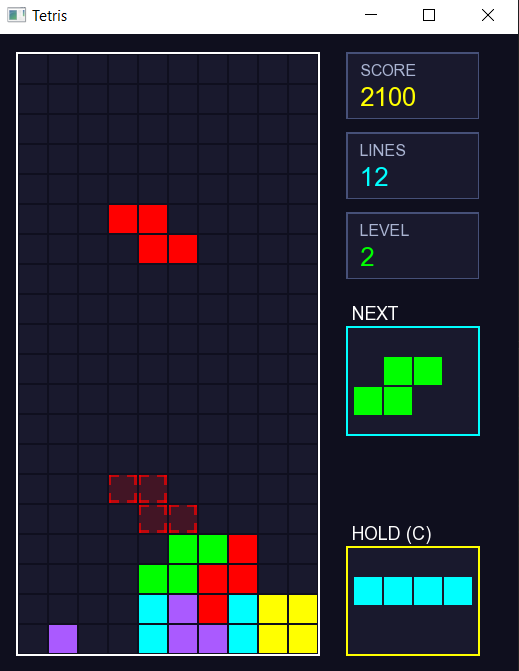

# Tetris (PF Semester Project)

Tetris game made in C++ using SFML 3.0.2 for our Programming project.

## Team Members
- Taib Asim (26L-0541)
- Anas Basharat (26L-0503)
- Muhammad Suhaib (26L-0518)

## Gameplay Screenshot

## Controls
- **Left / Right Arrow** or **A / D**: Move piece left and right
- **Down Arrow** or **S**: Move piece down faster
- **Up Arrow** or **W**: Rotate piece
- **Space**: Hard drop
- **C**: Hold / swap current piece (once per piece)
- **Enter**: Select menu option / go back to menu after Game Over
- **Esc**: Save game and return to main menu

## How to Run
Make sure CMake, a C++ compiler (MinGW or MSVC), and SFML 3.0.2 are installed. Keep `pieces.txt`, `arial.ttf`, and the audio files in the project folder.

1. Clone the repository:
   git clone https://github.com/Taib-Asim/Tetris-game.git
   cd Tetris-game

2. Build using CMake:
   cmake -B build
   cmake --build build

3. Run the game:
   ./build/bin/main.exe